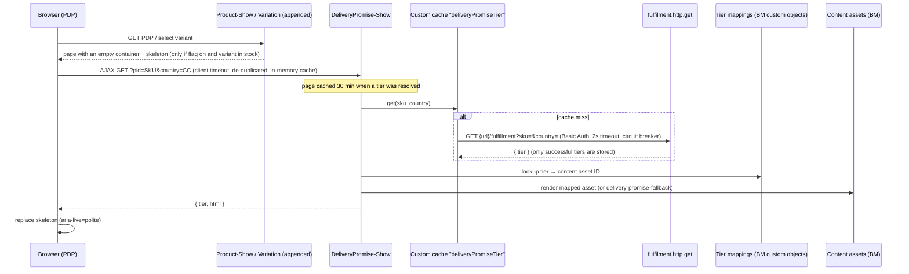

# app_custom_core – PDP Delivery Promise

Shows how fast an in-stock product can be delivered to the shopper's country on the PDP. The block sits directly below the availability information. The delivery tier comes from an external fulfilment service. Tier-to-content-asset mappings and the copy, icon, image and colour are managed in Business Manager, so a new tier can be added without a code deployment.

There are no changes in `app_storefront_base`. Everything is either an extension (`server.extend` + `server.append`) or a template override in this cartridge.

- Business user guide: [docs/BUSINESS_GUIDE.md](docs/BUSINESS_GUIDE.md)

---

## 1. Architecture



The service is never called during PDP rendering. The PDP HTML is rendered and cached exactly as before, and the delivery block is loaded asynchronously. So a slow or failing service cannot block or break the page.

### Files

| File | Purpose |
| --- | --- |
| `cartridge/controllers/Product.js` | Extends base `Product`. Appends `viewData.deliveryPromise` to `Show`, `ShowInCategory` and `Variation`. Wrapped in try/catch so it can never break the PDP. |
| `cartridge/controllers/DeliveryPromise.js` | `DeliveryPromise-Show` JSON endpoint (`pid`, `country`) → `{ tier, html }` |
| `cartridge/scripts/services/fulfilmentService.js` | `LocalServiceRegistry` definition (`fulfilment.http.get`): Basic Auth header, response parsing, `mockCall` |
| `cartridge/scripts/helpers/deliveryPromiseHelpers.js` | Feature flag, country resolution, stock check, tier caching, BM tier mapping lookup, content asset → view model |
| `cartridge/scripts/hooks/deliveryPromiseHtmlHead.js` | `app.template.htmlHead` hook. Adds the Montserrat font only when the feature is on |
| `cartridge/templates/default/product/components/productAvailability.isml` | Override of the base template. Same markup, plus the delivery promise container |
| `cartridge/templates/default/deliveryPromise/*.isml` | Container, skeleton, block and font loader |
| `cartridge/client/default/js/components/deliveryPromise.js` | Loads the block and reacts to `product:afterAttributeSelect` |
| `cartridge/client/default/scss/deliveryPromise.scss` | Responsive BEM styles, tier themes, skeleton, reduced motion |
| `caches.json`, `hooks.json`, `package.json` | Custom cache and hook registration |
| `webpack.config.js`, `build.js` | Standalone build for this cartridge's JS/SCSS (into `cartridge/static`) |
| `site_import/delivery-promise/` | Metadata, service, site preferences, sample tier mappings and content assets |

---

## 2. Setup

### 2.1 Build and upload

From `storefront-reference-architecture/`:

```bash
npm install
npm run build             # base cartridge + compile:custom (this cartridge)
npm run compile:custom    # only this cartridge's JS/SCSS
npm run uploadCartridge   # uploads app_storefront_base, modules, bm_app_storefront_base and app_custom_core
```

`dw.json` must point to your sandbox, as usual for SFRA.

### 2.2 Cartridge path

In *Administration > Sites > Manage Sites > RefArch > Settings*:

```
app_custom_core:app_storefront_base
```

### 2.3 Data import

Zip the `site_import/delivery-promise` folder. Upload and import it in *Administration > Site Development > Site Import & Export*. It contains:

| File | Content |
| --- | --- |
| `meta/system-objecttype-extensions.xml` | Site preferences and content attributes for the delivery promise feature. |
| `meta/custom-objecttype-definitions.xml` | Site-scoped custom object type `DeliveryPromiseTier`, keyed by fulfilment tier. Its *Delivery Promise Tier Mapping* attribute group exposes the content asset ID and enabled flag in BM; the tier is the custom-object key. |
| `sites/RefArch/site.xml` | RefArch site configuration, including the custom cartridge path. |
| `sites/RefArch/custom-objects/DeliveryPromiseTier.xml` | Starter mappings for `SAME_DAY`, `NEXT_DAY` and `STANDARD`; these records can be edited in BM. |
| `services.xml` | Credential `fulfilment.http.credentials`, profile `fulfilment.http.profile` (2s timeout, circuit breaker 5 errors / 10s), service `fulfilment.http.get` |
| `sites/RefArch/preferences.xml` | Turns the feature on, with country `US` and a 5000 ms client timeout |
| `libraries/RefArchSharedLibrary/library.xml` | Content assets `delivery-promise-same-day`, `delivery-promise-next-day`, `delivery-promise-standard`, `delivery-promise-fallback` |
| `libraries/RefArchSharedLibrary/static/default/images/truck.png` | Truck image referenced by the imported delivery promise content assets. |

If your site uses another library ID, change `library-id` in `library.xml` before importing.


After the import, go to *Administration > Operations > Services > Credentials > `fulfilment.http.credentials`*. Set the **URL** (without `/fulfillment`), the **User** and the **Password**. The password is intentionally not included in the import.


### 2.4 Configuration reference

| Setting | Where | Default | Notes |
| --- | --- | --- | --- |
| `deliveryPromiseEnabled` | Site Preferences > Custom > Delivery Promise | `false` | Feature flag. When off, there are no calls and no markup, CSS, JS or font on the PDP. |
| `deliveryPromiseDefaultCountry` | Site Preferences | `US` | Used when the request locale has no country (e.g. `default` locale) |
| `deliveryPromiseClientTimeout` | Site Preferences | `5000` | Browser AJAX timeout in ms, clamped to 1000–15000 |
| Tier mapping | Administration > Site Development > Custom Objects > `DeliveryPromiseTier` | One record per tier | Key is the normalized fulfilment tier; attributes are `contentAssetId` and `enabled`. |
| Service timeout | Service profile `fulfilment.http.profile` | `2000` ms | Server-side timeout for the fulfilment call |
| Circuit breaker | Service profile | 5 calls / 10 s | Stops calling a failing service for a while |
| Tier cache | `caches.json` → `deliveryPromiseTier` | 1800 s | Can be cleared or disabled under *Administration > Operations > Custom Caches* |
| Page cache | `DeliveryPromise-Show` | 30 min | Only applied when a tier was resolved. Failures are never cached. |

---

## 3. How it works

### 3.1 Eligibility

The block is requested only when all of these are true:

- the feature flag is on
- the product model is `readyToOrder` and `available`
- the API product is online, is not a master, variation group, set or bundle, and `availabilityModel.isInStock(qty)` is true

`DeliveryPromise-Show` checks the flag, the product and the stock again on the server. It also validates `country` against `^[A-Z]{2}$`. A crafted URL therefore cannot trigger arbitrary service calls.

On variant change, base `Product-Variation` is appended with a fresh `deliveryPromise` config. The client JS reads `response.data.deliveryPromise` on `product:afterAttributeSelect` and shows, reloads or hides the block. The container is rendered only on the full PDP (`Product-Show` / `ShowInCategory`) and only for the main product (`product.id === pdict.product.id`). Quick view and set/bundle child products do not show the block.

### 3.2 Country

The country comes from the request locale (e.g. `en_US` → `US`). The locale is part of every SFRA URL, so the response is page-cache safe. If there is no country, `deliveryPromiseDefaultCountry` is used.

### 3.3 Service call

```
GET {credential.url}/fulfillment?sku={sku}&country={country}
Accept: application/json
Authorization: Basic base64(user:password)
```

- The `Authorization` header is built explicitly from the BM credential. Credentials never appear in code or logs; `getRequestLogMessage` excludes the header.
- Any non-200 response, a missing or malformed `tier`, a timeout or an open circuit breaker counts as a **failure**.
- A well-formed tier must have an enabled `DeliveryPromiseTier` custom-object record. An unmapped or disabled tier renders the fallback asset rather than being rejected just because it is new.
- On failure, the `delivery-promise-fallback` asset is rendered if it is online. Otherwise the block is hidden.
- Logs go to category `DeliveryPromise` (custom log prefix `deliveryPromise`). Service communication logs use the `fulfilment` prefix.

### 3.4 Caching: "repeat views don't hit the service"

| Layer | Scope | What is cached |
| --- | --- | --- |
| Browser (JS) | Page lifetime | Successful HTML per URL. Requests in flight are de-duplicated, so switching A → B → A does not repeat calls. |
| Page cache | 30 min, per `pid` + `country` + locale | `DeliveryPromise-Show` response when a tier was resolved |
| Custom cache `deliveryPromiseTier` | 30 min, per app server | Tier per `sku_country`. Failures are not stored, so the service is retried next time. |
| Service circuit breaker | Profile | Protects a failing service from being hammered |

The **content** is not stored in the tier cache. Only the tier is. Content asset edits therefore appear as soon as the page cache entry expires, or straight away after clearing the page cache.

### 3.5 Loading, fallback and layout shift

- The server-rendered container already contains a skeleton with the same dimensions as the card (`min-height` matches the card). The page reserves the space from the first paint.
- The container has `role="region"`, `aria-live="polite"` and `aria-busy`. The skeleton includes visually hidden "Checking delivery options…" text for screen readers.
- When the content loads, the skeleton is replaced with a short fade (disabled with `prefers-reduced-motion`).
- On timeout or error, the fallback asset is shown, or the container is hidden. No JS errors are thrown. All AJAX errors are handled.

### 3.6 Font (Montserrat)

- The font is only added when the feature is on, via the existing `app.template.htmlHead` hook, so `htmlHead.isml` is not overridden.
- It uses `preconnect` to `fonts.googleapis.com` and `fonts.gstatic.com`. The stylesheet is loaded with `media="print" onload="this.media='all'"`, so it is **non-render-blocking**. `display=swap` is used, and there is a `<noscript>` fallback.
- `font-family: 'Montserrat', 'Montserrat Fallback', …`. The fallback is a `size-adjust`ed local Arial, which limits the reflow when the font swaps in.
- Only the weights actually used are requested (400, 600, 700).

### 3.7 Accessibility

- Semantic heading and paragraphs. Icons are `aria-hidden="true"`.
- The image uses `dpImageAlt`. With no alt text, it is treated as decorative (`alt=""`).
- Default tier colours meet WCAG AA contrast against white.
- The block is announced politely when it changes on variant selection.

### 3.8 Security

- All content is ISML-encoded. Icons are whitelisted (enum + server-side check). `dpAccentColor` must match `^#([0-9a-f]{3}|[0-9a-f]{6})$`, otherwise it is ignored, which prevents CSS injection.
- `pid` and `country` are validated server-side, and only in-stock, online, sellable products trigger a call.
- Credentials live only in the BM service credential.

---

## 4. Mock fulfilment service

### 4.1 Beeceptor (recommended for the demo)

1. Create an endpoint at <https://beeceptor.com>, e.g. `sfcc-fulfilment` → `https://sfcc-fulfilment.free.beeceptor.com`.
2. Put that URL in the `fulfilment.http.credentials` credential. Use any user and password; Beeceptor does not validate them, but the header is still sent and visible in Beeceptor's request log.
3. Add **Mocking Rules**. Rules are matched top-down, so put the specific SKUs first. Replace the SKUs with in-stock variant IDs from your catalog. You can find them in *Merchant Tools > Products*, or open a PDP and select a variant; the `pid` is in the URL.

| # | Method | Request path (contains) | Status | Delay | Body |
| --- | --- | --- | --- | --- | --- |
| 1 | GET | `sku=<SLOW_SKU>` | 200 | **4000 ms** | `{"sku":"<SLOW_SKU>","country":"US","tier":"SAME_DAY"}` |
| 2 | GET | `sku=<ERROR_SKU>` | **500** | 0 | `{"error":"internal_error","message":"Fulfilment backend unavailable"}` |
| 3 | GET | `sku=<SAME_DAY_SKU>` | 200 | 0 | `{"sku":"<SAME_DAY_SKU>","country":"US","tier":"SAME_DAY"}` |
| 4 | GET | `sku=<NEXT_DAY_SKU>` | 200 | 0 | `{"sku":"<NEXT_DAY_SKU>","country":"US","tier":"NEXT_DAY"}` |
| 5 | GET | `/fulfillment` | 200 | 0 | `{"sku":"any","country":"US","tier":"STANDARD"}` (catch-all) |

Set `Content-Type: application/json` on each rule.

- **Rule 1 (slow SKU):** the 4 s delay exceeds the 2 s service timeout. The server gives up after 2 s and renders the fallback; the PDP is unaffected. If you raise the service timeout above 4 s, the block shows `SAME_DAY` after the delay. The PDP still loads instantly with the skeleton.
- **Rule 2 (error SKU):** simulates the backend failing. For an *intermittent* 500, toggle this rule on and off in Beeceptor. The tier is shown when it is off and the fallback when it is on. Failures are never cached, so the next view recovers immediately.

### 4.2 Mocky alternative

Create a mock at <https://designer.mocky.io> returning `{"tier":"NEXT_DAY"}`. You can append `?mocky-delay=4000ms` to the credential URL path for the slow scenario. Mocky ignores query parameters, so it returns one tier for all SKUs. Use one mock per tier and switch the credential URL to demo each tier.

### 4.3 Service framework mock mode (no network)

Enable **Mock mode** on the service `fulfilment.http.get` in BM. `mockCall` then answers in-process:

- SKUs ending in `ERROR400`, `ERROR401` or `ERROR500` return the corresponding status and a JSON body with `error` and `message` fields.
- A SKU ending in `ERROR` is retained as an alias for HTTP 500.
- Any other SKU gets a deterministic tier based on the SKU characters. The same SKU always returns the same tier.

### 4.4 Switching to the real service

No code change is needed. Update the URL, user and password in `fulfilment.http.credentials`, and disable mock mode. If the real path differs from `/fulfillment`, change the path in `fulfilmentService.js` in `createRequest`.

---

## 5. Testing

### 5.1 Manual test plan

| # | Scenario | Steps | Expected |
| --- | --- | --- | --- |
| 1 | Tier rendering | Open the PDP of a variant mapped to SAME_DAY, NEXT_DAY and STANDARD | The matching block appears below "Availability", in Montserrat |
| 2 | Variant switch | On a master PDP, select colour and size | No block until a variant is selected. The skeleton then shows, followed by the tier block. |
| 3 | Out of stock | Select an out-of-stock variant, or set its inventory to 0 | No block and no service call |
| 4 | Slow service | Use the slow SKU (4 s delay) | The PDP renders immediately. The skeleton is replaced by the fallback after ~2 s. |
| 5 | Failing service | Use the error SKU (500) | Fallback block (or hidden if the fallback asset is offline). No console errors. |
| 6 | Repeat views | Reload the same variant, and switch A → B → A | Beeceptor shows **one** request per SKU/country within 30 min. Switching back shows no new network request in DevTools. |
| 7 | BM editing | Change the heading, colour, icon or image of `delivery-promise-next-day`, then clear the page cache | The change is visible without a deployment |
| 8 | Add tier without deployment | Create a content asset and enabled `DeliveryPromiseTier` record; use Beeceptor or another HTTP mock to return that tier | The mapped content renders using the generic responsive card |
| 9 | Unmapped tier | Return a valid but unmapped tier code | The fallback asset renders and the response is not page-cached |
| 10 | Feature flag | Set `deliveryPromiseEnabled` = No and clear the page cache | No container, no CSS/JS request, no Montserrat request, no service calls |
| 11 | Responsive | Check at 375px, 768px and 1280px | Card stacks on mobile (image as a top banner); side-by-side on desktop |
| 12 | Accessibility | Screen reader, keyboard, and Lighthouse a11y | Region announced, no contrast or alt issues |
| 13 | Layout shift | Lighthouse or Performance panel on the PDP | No CLS from the block (the skeleton reserves space) |
| 14 | Locale/country | Switch the site locale (e.g. `en_GB`) | The request contains `country=GB` |

### 5.2 Useful checks

- **Service calls:** look at Beeceptor's request history, or the `service-fulfilment-*.log` communication log on the sandbox.
- **Errors:** check `customerror-*.log` and `custom-deliveryPromise-*.log`.
- **Cache:** use *Administration > Operations > Custom Caches > deliveryPromiseTier* to see hits and misses, or clear it.

### 5.3 Lint

```bash
npm run lint
```

---

## 6. Known limitations and trade-offs

- **Fallback offline:** if the service fails *and* `delivery-promise-fallback` is offline, the reserved space collapses. Keep the fallback asset online to avoid any shift.
- **Mobile without an image:** the mobile skeleton reserves an image banner. A tier asset without an image is therefore slightly shorter than the skeleton on mobile.
- **Google Fonts** is used for simplicity. For maximum privacy and performance, self-host the WOFF2 files in `cartridge/static/default/fonts` and change `fontLoader.isml` to a local `@font-face` with `preload`.
- **Content changes and page cache:** content changes are subject to the 30 min page cache of `DeliveryPromise-Show`. Clear the page cache for immediate effect.
- **Tier mappings:** new tier codes use the existing card structure and content fields. New layouts or new content fields still require a code deployment.
- The tier cache is per app server, so the service can be called once per server per SKU/country per 30 min.
